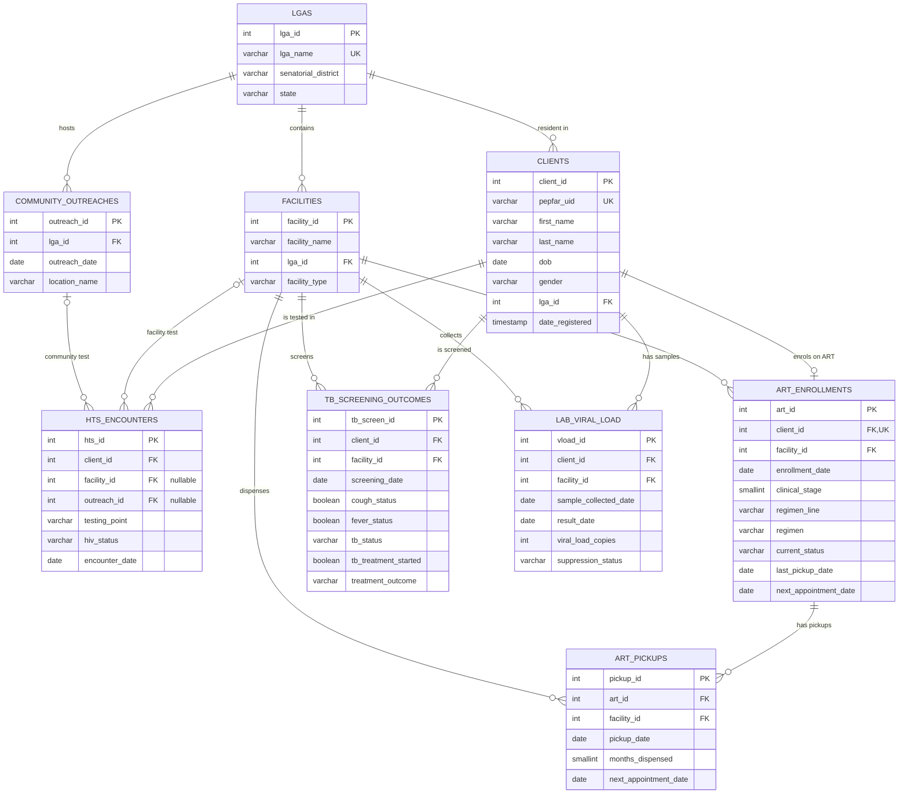

# ER Diagram: ECEWS SPEED Osun Hub

The diagram is written in Mermaid, which GitHub renders automatically. You can also open as preview inside of VS code to view the Rendered ER diagram.

## Cardinality notes

- **Client → ART enrolment is 1 : 0..1.** Not every tested client is HIV-positive. A client is enrolled at most once; a transfer updates `facility_id` and does not create a new enrolment.
- **HTS encounter → location is exactly one of facility or outreach.** This is enforced by `chk_hts_one_location`.
- **Enrolment → pickups is 1 : many.** This gives the full multi-month dispensing (MMD) history.
